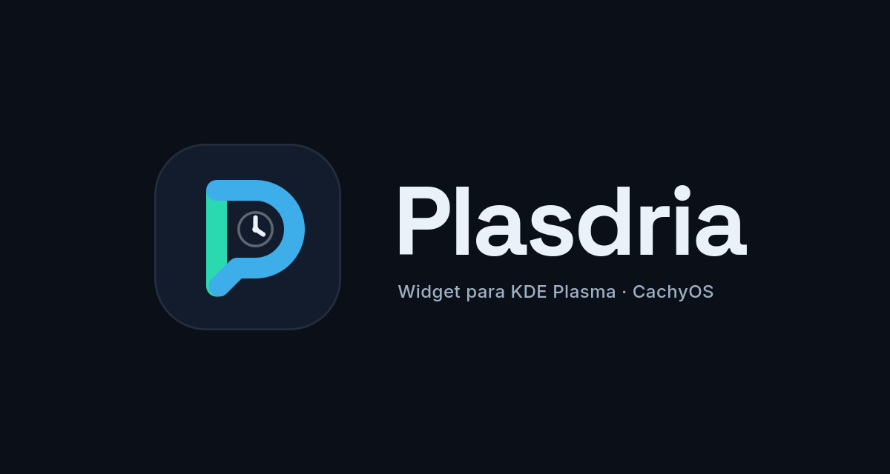
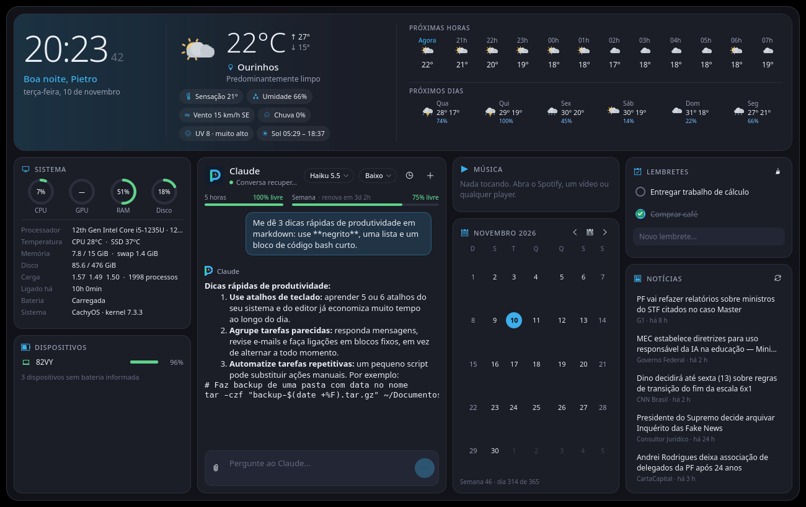
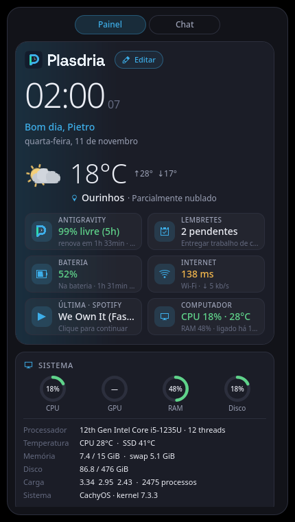

<div align="center">



**Seu assistente, sua música, sua rede e seu dia. Na área de trabalho.**

Um widget para KDE Plasma 6 com chat do Claude, música tocando agora, rede, lembretes, clima, notícias e monitoramento do sistema — em um painel escuro, responsivo e configurável.




</div>

## O que ele faz

| Cartão | Detalhes |
| --- | --- |
| **Painel geral** | A base do widget: logo do Plasdria, horário, saudação, data e clima resumido (temperatura, máxima/mínima, cidade e condição). Ao lado, um resumo do que importa agora: cota do Claude, lembretes pendentes, bateria, internet, música tocando (clique para pausar) e uso do computador. |
| **Rodapé do clima** | Detalhes de hoje (sensação, umidade, vento, chuva, UV e sol), as próximas horas e a semana, com chance de chuva. |
| **Chat com o Claude** | Respostas em tempo real e formatadas (negrito, listas, código), texto selecionável e botão de copiar. Escolha de modelo (Opus, Sonnet, Fable, Haiku) e de esforço. Anexe imagens e arquivos pelo clipe ou arrastando para o chat. Histórico com busca para retomar conversas do Claude Code (Desktop, CLI e IDE). |
| **Cotas** | Barras da cota de 5 horas e semanal, com o tempo até renovar. O ícone do painel mostra a cota de 5 h em um anel. |
| **Música** | Qualquer player compatível com MPRIS (Spotify, YouTube no navegador, VLC, Elisa…): capa, título, artista, barra de progresso clicável, tocar/pausar, anterior, próxima, aleatório, repetir e volume. O Spotify tem prioridade e um botão para abrir. A última música fica lembrada com a capa guardada: com o player fechado ou sem internet ela continua aparecendo, e um clique abre o Spotify e retoma do ponto em que parou. |
| **Rede** | Nome da rede, sinal do Wi-Fi, IP local, latência e gráfico de download/upload em tempo real. |
| **Lembretes** | Lista rápida com marcar como feito, remover e limpar concluídos. Fica salva nas configurações do widget. |
| **Sistema** | CPU, GPU, RAM e disco em anéis com cores por nível de uso, mais processador, temperaturas da CPU e do SSD, memória e swap, carga, processos, tempo ligado, bateria e versão do sistema. |
| **Calendário** | Mês atual com navegação, hoje destacado, semana do ano e dia do ano. |
| **Dispositivos** | Bateria do notebook e de periféricos que publicam essa informação (UPower/BlueZ). |
| **Notícias** | Lista de manchetes do Google News Brasil com fonte e horário, tema configurável (Tecnologia, Esportes, Economia…). |

O layout se adapta ao espaço: em telas largas, o **painel geral** fica em cima e os cartões e o chat embaixo, preenchendo todo o espaço; em tamanho médio, painel e cartões rolam à esquerda com o chat ao lado; quando estreito (como no painel do Plasma), há abas **Painel** / **Chat**.



## Configurações

Clique com o botão direito no widget → **Configurar Plasdria…**

- **Geral** — seu nome para a saudação, cidade (busca por nome) ou detecção automática, modelo e esforço padrão do Claude e tema das notícias.
- **Cartões** — escolha quais cartões aparecem.
- **Aparência** — cor de destaque, opacidade do fundo e animações.
- **Atalhos de teclado** — defina um atalho global para abrir o chat (página padrão do Plasma).

## Instalação

Requer Linux com **KDE Plasma 6**, compilador C++, Qt 6 (Base e Declarative), qmake, Make, Python 3 e `kpackagetool6`. Desenvolvido no CachyOS.

No CachyOS / Arch Linux:

```bash
sudo pacman -S --needed gcc make python qt6-base qt6-declarative kpackage
```

Para conversar, instale o [Claude Code](https://docs.claude.com/en/docs/claude-code) e entre com sua conta (assinatura Claude ou chave de API). Se ainda não estiver autenticado, rode `claude` e use `/login`.

Na pasta do projeto:

```bash
./install.sh
```

Depois procure **Plasdria** em **Adicionar widgets**. Ao atualizar uma instalação existente, recarregue o Plasma:

```bash
systemctl --user restart plasma-plasmashell.service
```

Para desinstalar:

```bash
kpackagetool6 -t Plasma/Applet -r local.plasdria
```

## Desenvolvimento

O projeto já vem configurado para o **VS Code** (`.vscode/`): abra a pasta e use **Terminal → Executar Tarefa…**

| Tarefa | O que faz |
| --- | --- |
| Compilar | Gera o plugin nativo e o pacote `plasdria.plasmoid` |
| Instalar no Plasma | Compila e instala/atualiza o widget |
| Testes | Compila e roda os testes (sem chamadas reais ao Claude) |
| Prévia (capturas) | Renderiza o widget fora do Plasma e salva PNGs em `build/preview/` |

Pela linha de comando: `./build.sh`, `./install.sh`, `bash tests/run.sh` e `qml6 tools/preview.qml -- <pasta> [--sem-rede]`.

## Como funciona

| Camada | Tecnologias |
| --- | --- |
| Interface | QML / Qt Quick, Kirigami (ícones e página de configurações) |
| Núcleo | C++17, Qt Core, Network, D-Bus e Concurrent |
| Assistente | Claude Code em modo `-p` com stream-json pela entrada/saída padrão |
| Música | MPRIS via D-Bus |
| Rede | `/proc/net/dev`, NetworkManager via D-Bus |
| Sistema e baterias | `/proc`, `/sys` (hwmon), UPower e BlueZ; `nvidia-smi` quando disponível |
| Clima e cidades | Open-Meteo (atual, por hora, 7 dias e geocodificação) |
| Notícias | RSS do Google News Brasil |

## Dados e privacidade

- O widget usa o login do Claude Code; não há chaves de API no código.
- As conversas ficam no Claude Code (`~/.claude/projects`). O Plasdria guarda só o estado de recuperação em `~/.local/share/plasdria/chat-state.json`, privado do usuário.
- **Perguntas, anexos e contexto enviados são processados pelo Claude.** O widget roda sem plugins, hooks ou servidores MCP do usuário e só libera ferramentas de leitura e busca (`Read`, `Glob`, `Grep`, `WebSearch`, `WebFetch`): não altera arquivos nem executa comandos.
- A última música tocada fica em `~/.local/share/plasdria/media.json` e as capas em `~/.cache/plasdria/art` (no máximo 150).
- Clima, cidades e notícias fazem consultas HTTPS. Com a cidade definida nas configurações, a localização por IP não é consultada.
- A latência é medida abrindo uma conexão com `www.google.com:443` a cada 20 segundos.

## Estrutura

```text
native/        Núcleo C++: Claude, clima/sistema, música (MPRIS) e rede
package/       Pacote do Plasma: metadados, configurações e interface QML
  contents/config/   Esquema e páginas de configuração
  contents/ui/       Cartões, chat, layout e recursos visuais
images/        Logos e ícones originais
docs/          Banner e capturas do README
tests/         Testes do chat (Claude simulado) e da música (player simulado no D-Bus)
tools/         Prévia/capturas fora do Plasma
```

## Licença

[MIT](LICENSE). Parte do núcleo (clima, sistema e histórico) vem do [PRAGUS](https://github.com/gustavoprad0/PRAGUS), também MIT. Projeto independente, sem afiliação com a Anthropic, o KDE ou os provedores de dados.
