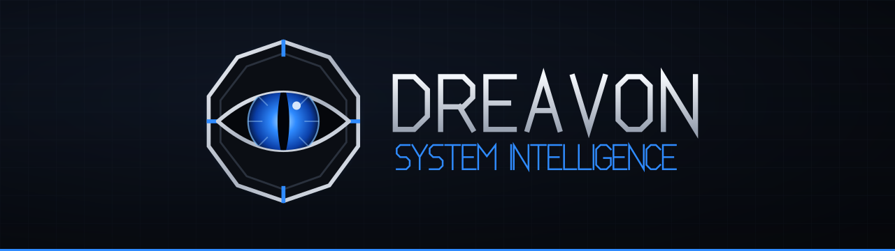

<div align="center">



**O guardião silencioso da sua área de trabalho.**

Um widget de desktop para **Windows** com chat multi-IA, música, rede, lembretes, clima, notícias e monitoramento do sistema, em um painel escuro e futurista.


</div>

> **Em desenvolvimento.** O DREAVON já abre no Windows numa janela própria, com o painel geral, o chat, o clima, as notícias, os lembretes, o calendário, o sistema, os dispositivos, a rede e a música. O código vem do [Plasdria](https://github.com/PietroAlexandria/Plasdria), um widget para KDE Plasma (Linux), e está sendo adaptado em etapas. Acompanhe o andamento no [roadmap](#roadmap).

## O que é o DREAVON

O DREAVON (*System Intelligence*) reúne em um só painel o que importa durante o dia: um assistente de IA, o que está tocando, a saúde do computador e da rede, e os compromissos. A ideia é ser discreto como um guardião: fica ali, em silêncio, e mostra o que precisa quando você olha.

A identidade segue o mesmo espírito:

| Elemento | Escolha |
| --- | --- |
| Nome | DREAVON |
| Subtítulo | System Intelligence |
| Cores | preto, grafite, azul elétrico e prata |
| Símbolo | olho de dragão dentro de uma moldura de runa |
| Personalidade | guardião silencioso |
| Interface | modo escuro futurista, com detalhes de fantasia |

## O que vem da base (Plasdria)

Estas são as funções da base Linux que o DREAVON pretende ter no Windows. O painel geral, o clima, as notícias, o calendário, o chat (testado com o Claude), o sistema, a rede e a música já funcionam na janela do Windows; o resto segue o roadmap.

| Recurso | Na base Linux | Previsão para o Windows |
| --- | --- | --- |
| Painel geral | relógio, saudação, clima resumido e visão do dia | reaproveitar a interface QML |
| Chat multi-IA | Antigravity, Claude, Codex, Gemini CLI, Ollama e APIs compatíveis com OpenAI | portar a chamada dos CLIs e testar no PATH do Windows |
| Música | MPRIS (D-Bus) | SMTC, o controle de mídia do Windows |
| Rede | `/proc/net/dev` e NetworkManager | IP Helper e WLAN API |
| Sistema | CPU, GPU, RAM, disco, temperaturas e bateria via `/proc` e `/sys` | PDH, `GlobalMemoryStatusEx` e API de energia do Windows |
| Lembretes com alarme | notificação do sistema | notificação toast do Windows |
| Calendário, clima e notícias | iCal, Open-Meteo e Google News | já dependem só de rede, devem portar com pouco ajuste |

O mapeamento completo, com as dúvidas em aberto, está em [`docs/windows-port.md`](docs/windows-port.md).

**Compilar e abrir no Windows** (Qt 6, MSVC, CMake e Ninja instalados): `.\build-windows.ps1 -Run`. Sem `-Run`, só compila o núcleo (`package\contents\ui\bridge\dreavonplugin.dll`). Detalhes em [`docs/diario/02-casca-windows.md`](docs/diario/02-casca-windows.md).

## Roadmap

- [x] Repositório próprio, com o histórico e os créditos do Plasdria
- [x] Plano da adaptação e convenção de branches
- [x] **1.** Compilar o núcleo no Windows (CMake, Qt 6, MSVC) isolando o código exclusivo de Linux ([PR #3](https://github.com/Pedro-Andreotti/DREAVON/pull/3))
- [x] **2.** Casca própria em janela Qt Quick, sem Plasma, com bandeja, nome e logo do DREAVON e chave da API no Gerenciador de Credenciais ([plano](docs/passo-2-casca.md), [diário](docs/diario/02-casca-windows.md), [PR #6](https://github.com/Pedro-Andreotti/DREAVON/pull/6))
- [x] **3.** Partes portáveis: clima, notícias, lembretes, calendário e chat, com os CLIs de IA executados sem passar pelo `cmd.exe` ([diário](docs/diario/03-partes-portaveis.md))
- [x] **4.** Sistema: CPU, RAM, swap, disco, bateria, GPU e temperatura do SSD — **concluído parcialmente**: a temperatura da CPU segue indisponível no Windows (sem fonte nativa sem administrador) ([diário](docs/diario/04-sistema-windows.md))
- [x] **4b.** Dispositivos: USB e Bluetooth pela lista do Windows e bateria do mouse Logitech pelo receptor (HID++, só leitura) — a bateria do fone Bluetooth segue em aberto ([diário](docs/diario/05-dispositivos-windows.md))
- [x] **5.** Rede: tráfego (só placas físicas), IP, tipo, nome e sinal do Wi-Fi, latência e modo offline ([diário](docs/diario/06-rede-windows.md))
- [x] **6.** Música via SMTC (C++/WinRT): Spotify, navegadores e outros players, com capa, posição e controles ([diário](docs/diario/07-musica-windows.md))
- [ ] **7.** Notificações, atalho global, bandeja do sistema e instalador
- [ ] Identidade final: ícone do aplicativo e telas

## Tecnologias

| Camada | Tecnologias |
| --- | --- |
| Interface | QML / Qt Quick |
| Núcleo | C++17, Qt 6 (Core, Qml, Network, Gui, Concurrent) |
| Alvo | Windows 10/11, MSVC e CMake (a confirmar) |
| Origem | KDE Plasma 6, Kirigami, D-Bus (a substituir no Windows) |

## Estrutura

```text
native/        Núcleo C++ (chat, clima, sistema, música e rede)
package/       Interface QML e configurações (formato de plasmoide da base)
docs/          Plano do port, notas de desenvolvimento e identidade visual
  brand/       Logo, marca e banner do DREAVON
app/           Inicializador nativo (dreavon.exe), para o futuro instalador
windows/       Ponto de entrada no Windows e substituto mínimo do Kirigami
tests/         Testes herdados (chat simulado e música simulada)
tools/         Prévia da interface fora do Plasma
```

## Executar a base Linux

Enquanto o port não termina, a base ainda pode ser compilada em Linux com KDE Plasma 6, como no Plasdria: veja o [README original](https://github.com/PietroAlexandria/Plasdria#instalação). Os scripts `build.sh` e `install.sh` são da base Linux e não foram testados depois da troca de nome (o identificador do pacote agora é `local.dreavon`).

## Contribuindo

Cada etapa do roadmap é uma branch, com Pull Request e *squash merge*. As regras estão em [`CONTRIBUTING.md`](CONTRIBUTING.md).

## Créditos e licença

[MIT](LICENSE). O DREAVON é uma adaptação do [Plasdria](https://github.com/PietroAlexandria/Plasdria) (© Pietro Alexandria, MIT), que inclui código do [PRAGUS](https://github.com/gustavoprad0/PRAGUS) (MIT). Os avisos de copyright originais foram mantidos. No Windows, os ícones da interface são um subconjunto do tema [Breeze](https://invent.kde.org/frameworks/breeze-icons) (© Uri Herrera e outros, LGPL-3.0-or-later), em `windows/qml/org/kde/kirigami/icons/`, com o aviso em `COPYING-ICONS`. Projeto independente, sem afiliação com a Anthropic, a Microsoft, o KDE ou os provedores de dados.
