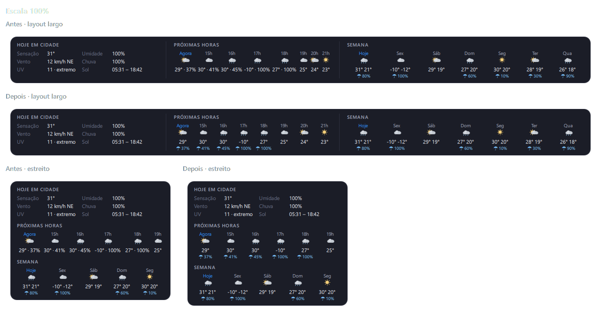
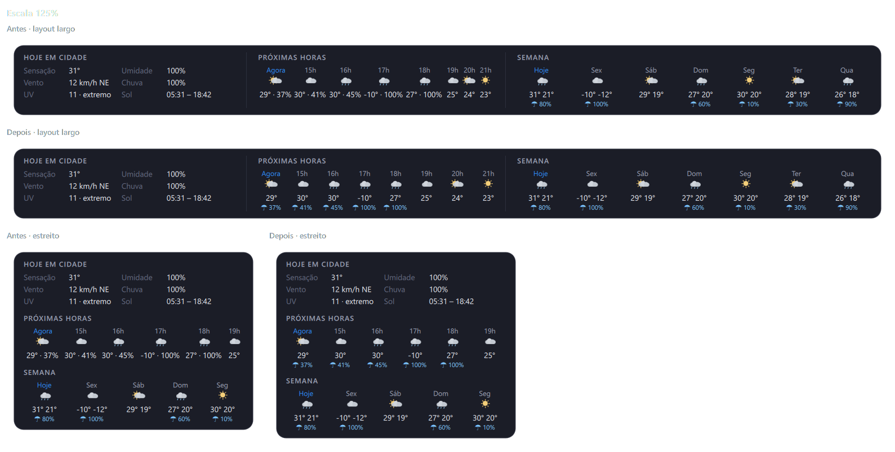
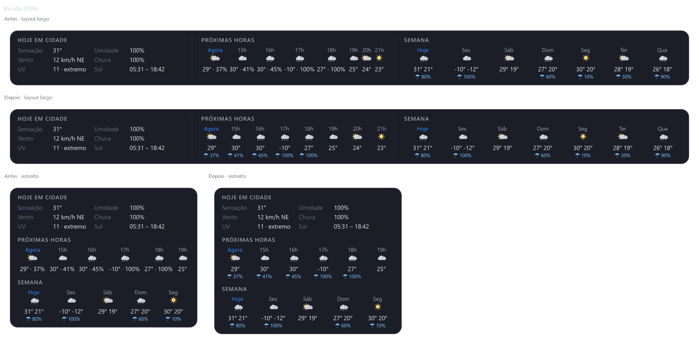

# 06 — Cartão "Rede" no Windows

Data: 2026-11-12 · Branch: `feat/rede-windows`

## Causa
No Windows, o cartão de Rede só tinha a latência e o IP, as duas partes já portáveis. O resto dependia do Linux:
- **Taxas:** `sampleRates()` lia `/proc/net/dev`, que não existe no Windows. As taxas ficavam paradas em 0.
- **Nome, tipo e sinal:** `refreshConnection()` perguntava ao NetworkManager pelo D-Bus. Esse trecho fica atrás de `QT_DBUS_LIB` e não roda no Windows, então o cartão ficava sem nome, tipo e sinal.
- **IP:** vinha do `QNetworkInterface`, com o filtro de nomes do Linux (`lo`, `veth`, `docker`…). No Windows, ele podia pegar a primeira interface ligada, inclusive uma VPN.

## O que foi implementado
| Arquivo | Mudança | Motivo |
| --- | --- | --- |
| `native/networkinfo_win.h/.cpp` (novo) | `counters()`: contadores de bytes por interface (`GetIfTable2`). `primary()`: interface da melhor rota (`GetBestInterfaceEx`) com nome, tipo e IPv4 (`GetAdaptersAddresses`, `GetIfEntry2`) e, no Wi-Fi, SSID e sinal (`WlanOpenHandle`, `WlanQueryInterface`) | APIs documentadas, só de leitura, sem administrador e sem abrir processos |
| `native/networkclient.h/.cpp` | No Windows (`#ifdef Q_OS_WIN`): taxas pela diferença dos contadores a cada 1 s, conexão a cada 10 s e na hora em que uma interface liga ou desliga. Nova propriedade `connectionHint`. O caminho do Linux foi para o `#else` sem mudança | Mesmo cartão e mesmas propriedades nos dois sistemas |
| `package/contents/ui/NetworkCard.qml`, `ToolTipText.qml` | Dica ao passar o mouse no nome quando o Windows bloqueia o Wi-Fi. A dica ganhou `maxWidth` opcional, com quebra de linha | Explicar o "indisponível" sem inventar valor |
| `CMakeLists.txt` | `iphlpapi`, `wlanapi` e `ws2_32`, só no `WIN32` | Bibliotecas do sistema (SDK do Windows), nenhuma dependência de terceiros |

Comportamento:
- **Taxas por interface:** só entram interfaces presentes nas duas leituras. Uma interface que surge ou some, como na troca de Wi-Fi para cabo, não gera pico falso.
- **"Indisponível" nunca vira 0:** sem tabela de interfaces ou sem placa física ligada, as taxas ficam em `-1` e o cartão mostra "—". O gráfico registra 0 nesses segundos.
- **Offline:** sem rota para a internet, nome, tipo, IP e sinal são limpos e o cartão mostra "Sem conexão"/"offline". Quando a última placa física desliga, o "offline" aparece na hora, sem esperar a medição de latência falhar.
- **Troca de interface:** quando muda o conjunto de placas ligadas, a conexão e a latência são medidas na hora e de novo 3 s depois. Logo após reconectar, o DNS ainda pode não estar pronto.
- **Diagnóstico:** categoria `dreavon.network`, desligada por padrão (`QT_LOGGING_RULES="dreavon.network.info=true"`). Registra só contagens e durações, sem nomes, IPs nem identificadores.
- **Custo:** cada leitura da conexão levou de 29 a 49 ms. As taxas são lidas uma vez por segundo, por uma chamada à API (`GetIfTable2`).

## Critério de interfaces (taxas)
Uma interface é contada quando atende às quatro condições:
1. `HardwareInterface` = verdadeiro: é placa física. Isso tira VPNs, Hyper-V (`vEthernet`), WSL, VirtualBox, TAP e Wi-Fi Direct, que o Windows marca como virtuais.
2. `FilterInterface` = falso: o Windows empilha "filtros" sobre cada placa (QoS, WFP etc.), e cada um repete os mesmos bytes. Contá-los dobraria o tráfego.
3. `OperStatus` = ligada (`IfOperStatusUp`).
4. Tipo Ethernet, Wi-Fi (802.11) ou banda larga móvel (WWAN). Loopback, túnel e PPP ficam de fora.

Pontes: o adaptador da ponte é virtual e fica de fora. As placas que fazem parte dela são contadas, então o tráfego não se repete.

Nesta máquina: 1 interface contada (o Wi-Fi) e 53 ignoradas, entre elas um adaptador de VPN ligado.

**Conexão principal (nome, tipo, IP):** é a interface da melhor rota até um destino público (`1.1.1.1`, ou `2606:4700:4700::1111` se não houver rota IPv4). A consulta só olha a tabela de rotas e não envia nenhum pacote.

Tipos, com os mesmos rótulos do Linux:
- Wi-Fi;
- Cabo (Ethernet física);
- Móvel;
- VPN (túnel ou PPP);
- Rede (adaptador virtual).

Um adaptador virtual só conta como conexão se houver alguma placa física ligada (ver "Validação").

## SSID e permissão de localização
- Nas versões recentes do Windows 11, um app da área de trabalho só recebe o SSID e o sinal pela WLAN API com a localização permitida. Sem ela, `WlanQueryInterface` devolve `ERROR_ACCESS_DENIED`. O sinal vem na mesma resposta, então também fica indisponível.
- **Nesta máquina** (Windows 11, compilação 26300): a localização e "Permitir que aplicativos da área de trabalho acessem sua localização" estão **ligadas**. Isso foi verificado só pela leitura do registro (`CapabilityAccessManager\ConsentStore\location`), sem alterar nada.
- Com a permissão ligada, o SSID chegou ao app e bateu com o do `netsh wlan show interfaces` (comparação por hash, sem registrar o nome). O sinal ficou em 87–88% na rede doméstica e em 46% em outra rede usada no teste.
- **Sem a permissão:** o cartão mostra "Nome da rede indisponível", sem sinal, e uma dica ao passar o mouse. A dica explica como habilitar: Configurações > Privacidade e segurança > Localização, ligar "Serviços de localização" e "Permitir que aplicativos da área de trabalho acessem sua localização". O DREAVON não pede nem altera a permissão. Este caminho **não foi verificado** (ver abaixo).
- Nenhum aviso ou pedido de permissão do Windows apareceu durante os testes.

## DREAVON x Windows
Comparação sem copiar valores reais. IP e nome foram comparados por hash; o resultado registrado é só "igual/diferente".

| Item | DREAVON | Windows | Resultado |
| --- | --- | --- | --- |
| Tipo | Wi-Fi | `Get-NetAdapter`: mídia 802.11 | igual |
| Interface principal | a da melhor rota | `Find-NetRoute -RemoteIPAddress 1.1.1.1` | igual |
| IPv4 | presente | IPv4 da rota em `Find-NetRoute`/`Get-NetIPAddress` | igual (hash) |
| Nome (SSID) | lido | `netsh wlan show interfaces` | igual (hash) |
| Adaptador de VPN ligado | fora da soma das taxas | `Get-NetAdapter`: Virtual = verdadeiro | fora, como deveria |

**Taxas x `Get-Counter '\Interface de rede(*)\Bytes recebidos/s'`.** Este Windows está em português, então o contador tem nome localizado. A soma do contador usou só as placas físicas ligadas.
- **Repouso (14 s):** as duas leituras ficaram entre 0,5 e 2 KB/s e diferiram em poucas centenas de bytes por segundo, de 0 a 5% quando alinhadas no tempo.
- **Download real (4 × 50 MB do arquivo de teste da Cloudflare, cerca de 11 s):**
  - DREAVON somou **199,9 MB** e o `Get-Counter` **196,9 MB** (+1,5%). Foram 200 MB baixados, mais o tráfego de protocolo.
  - Pico de ~30–38 MB/s (~240–300 Mb/s) nos dois.
  - Segundo a segundo, a diferença é maior, porque as leituras estão defasadas em ~0,4 s. O total da janela é a comparação justa.
- **Gerenciador de Tarefas:** a comparação lado a lado durante o download **não foi verificada** com números. O Gerenciador usa os mesmos contadores do sistema.

**Validação com o usuário** (monitor gravando uma linha por segundo, só rótulos e números):
1. **Primeira rodada, desligando o Wi-Fi pelo sistema:** o cartão foi para "Rede", com nome e IP do adaptador de VPN. Ele continua ligado com rota própria, e o Windows o apontava como "melhor rota". Além disso, o "online" ficou preso por ~5 s. **Corrigido:**
   - adaptador virtual sem placa física ligada passa a contar como offline;
   - a queda da última placa física marca offline na hora.
2. **Segunda rodada, com a correção:**
   - ao desligar o Wi-Fi, o cartão foi para offline **no mesmo segundo**, com tipo, nome e IP vazios, "—" nas taxas e sem a VPN;
   - ao religar, Wi-Fi, nome, sinal e taxas voltaram em ~1 s;
   - o "online" levou **~18 s** para voltar, porque a medição de latência da reconexão falhou (DNS ainda não pronto) e a próxima só vinha no ciclo de 20 s. Por isso a nova medição 3 s após a troca.
3. **Troca entre redes Wi-Fi:** nome e sinal acompanharam a troca (46% na outra rede).
4. **Cartão no app** (`build-windows.ps1 -Run`): confirmado pelo usuário ("testes ok"). Nenhum erro de QML no registro.

**Latência:** o código existente (abertura de conexão TCP até `www.google.com:443`) funciona no Windows sem mudança: 19–48 ms nesta rede.

**Linux:** não testado nesta máquina. Pela leitura do código:
- `networkinfo_win.*` só entra no build em `WIN32`;
- todo o código novo em `networkclient.cpp` fica atrás de `#ifdef Q_OS_WIN`, e o caminho antigo está inteiro no `#else`;
- o filtro `countedInterface` passou para `#ifndef Q_OS_WIN` só porque não é usado no Windows;
- `connectionHint` existe nos dois sistemas e fica vazio no Linux, onde a dica não aparece;
- `ToolTipText` sem `maxWidth` tem o mesmo tamanho de antes.

## Ajuste visual: rodapé do clima, "Próximas horas"
**Problema:** na faixa "Próximas horas", temperatura e porcentagem de cada hora ficavam numa linha só ("29° · 37%"), e as colunas tinham a largura do próprio texto, sem espaço entre elas. Com valores longos, uma coluna encostava na vizinha ("29° · 37%30° · 41%") e as últimas horas ficavam espremidas.

A porcentagem dessa faixa é a **chance de chuva** da hora (`precipitation_probability` do Open-Meteo), não a umidade. A umidade aparece só em "Hoje em detalhes".

**O que mudou** (`package/contents/ui/WeatherFooter.qml`):
- **Largura das colunas:** cada coluna de hora tem a mesma largura, com mínimo medido (`TextMetrics`) pelos textos mais longos possíveis ("-10°", "☂ 100%"), 6 px de espaço entre colunas e conteúdo centralizado.
- **Duas linhas:** temperatura em cima e chance de chuva embaixo, no mesmo estilo discreto que a "Semana" já usava ("☂ 37%", azul, fonte menor). Abaixo de 20% de chuva, a linha fica vazia, como antes.
- **Semana:** já tinha duas linhas e não estava colada, mas recebeu a mesma largura mínima ("-10° -12°") por segurança. "Hoje em detalhes" não tinha o problema.
- **O que não mudou:** cores, ícones, cabeçalhos e o número de horas (8 no layout largo, 6 nos compactos). As 8 horas cabem na janela padrão (1280 px), então não foi preciso mudar o tamanho da janela.

**Capturas antes e depois:**
- Feitas com dados fictícios ("CIDADE", "-10°", "100%"), sem localização real. Só o rodapé foi desenhado, nos layouts largo, médio e estreito.
- A escala de 125% e 150% foi simulada com `QT_SCALE_FACTOR`, que aumenta texto e medidas como a escala do Windows. A escala do sistema não foi alterada.
- Em nenhuma escala o texto foi cortado ou se sobrepôs depois da mudança.

## Não verificado
- **Cabo de rede:** a troca de Wi-Fi para cabo e de volta não apareceu no registro do monitor. A lógica é a mesma da troca observada, mas o rótulo "Cabo" não foi visto no app.
- **SSID sem permissão de localização:** a permissão está ligada nesta máquina e não foi alterada. A mensagem e o código `ERROR_ACCESS_DENIED` seguem a documentação, sem teste real.
- **Nova medição de latência 3 s após reconectar:** feita depois do último teste com o Wi-Fi, então o tempo de volta do "online" com ela não foi medido.
- **Gerenciador de Tarefas:** sem comparação numérica (ver acima).
- Banda larga móvel, VPN que leva toda a rota (o "VPN" do tipo), ponte de rede e IPv6-only.
- **Escala real do Windows** em 125% e 150%: só a simulação com `QT_SCALE_FACTOR`.
- **Linux:** não compilado aqui; só a leitura do código.

## Pendências
- **IPv6:** o cartão mostra só o IPv4, como no Linux. O IPv6 pode entrar se o cartão ganhar espaço para ele.
- **Notificação de mudança:** trocar o intervalo de 10 s da conexão por `NotifyIpInterfaceChange` ou `WlanRegisterNotification`, se quiser resposta imediata também na troca entre redes Wi-Fi. A troca de placa já reage em 1 s.
- **Cabo e permissão de localização:** testar a troca para cabo e o caminho sem permissão quando houver oportunidade.
